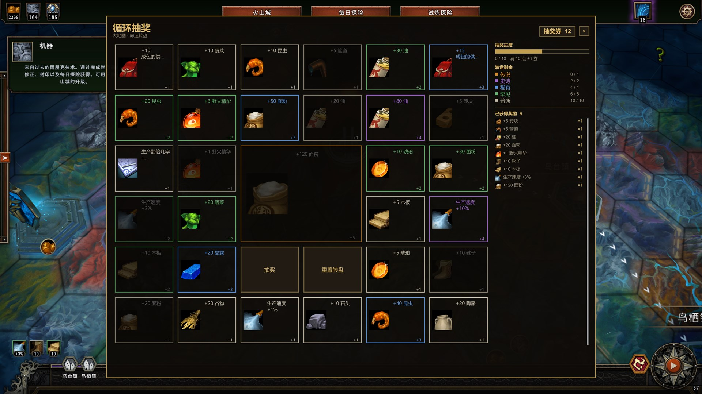
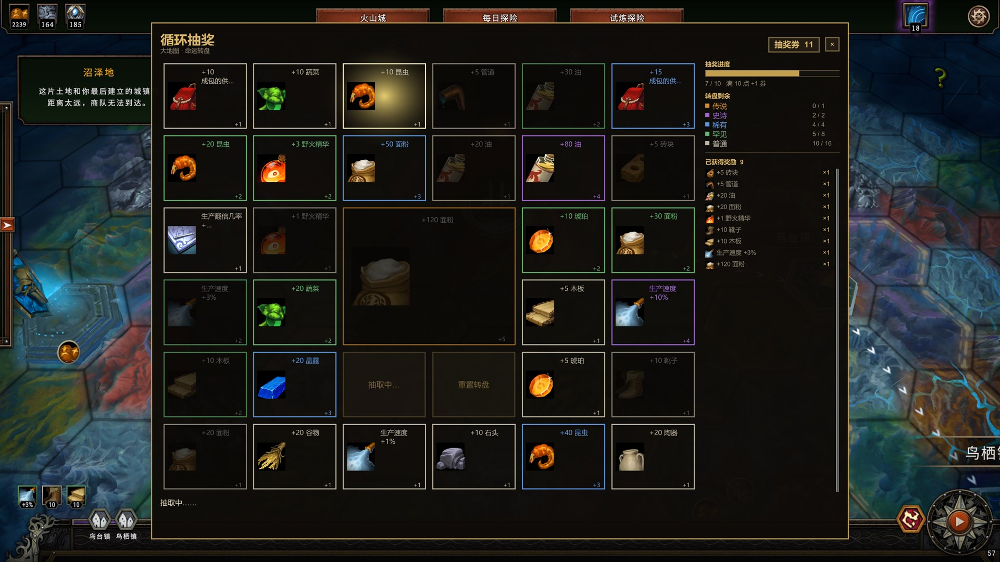
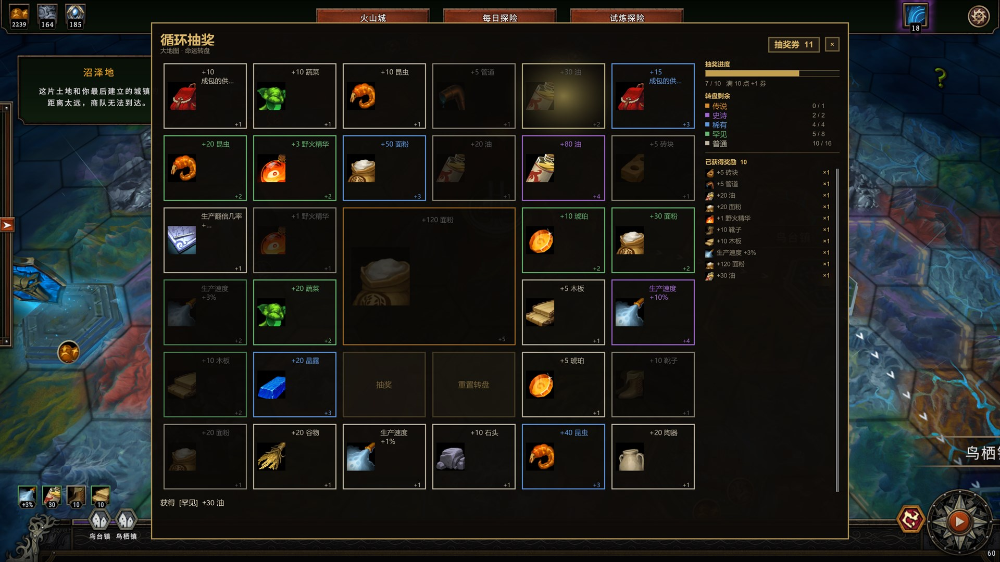
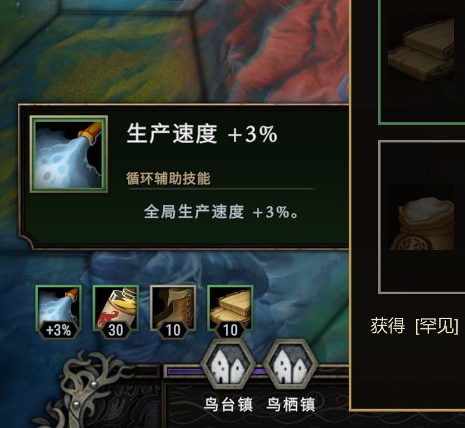

# Cycle Gacha / 循环抽奖

一个《Against the Storm / 风暴之城》的 BepInEx 5 + ATS_API mod。

每赢下一局获得 **10 张抽奖券**。在大地图按 **F7** 打开抽奖界面，抽取**单一物资或单一百分比加成**。奖励在整个世界循环内生效，循环结束（封印完成）时清空。

> 当前规则：奖励为单一类型；加成只保留百分比效果；每局 10 张券；进度满 10 点 +1 券并保留溢出；6×6 转盘中央是 2×2 传说卡，抽奖/重置按钮在它正下方；抽走传说卡后才能重置转盘。

---

## 截图

**抽奖界面** —— 6×6 紧凑卡片组，正中央是 2×2 的传说大卡，`抽奖` / `重置转盘` 就在它下方；
每张卡的边框与名称按稀有度上色，已抽走的卡片变暗并保留暗化的稀有度边框。



**抽取动画** —— 高亮光圈依次扫过卡片、跳过已抽走的卡位，越接近结果速度越慢；
结果在光圈停下时才结算，所以右侧列表不会提前剧透。



**抽中结果** —— 光圈停在中奖卡上并闪烁 5 秒，被抽中的卡片变暗留在原位，下方显示获得的奖励。



**大地图循环加成** —— 抽到的奖励会以原版循环加成的形式出现在大地图左下角，
鼠标悬停可以看到名称、分类与描述；图标边框同样是奖励的稀有度颜色。



---

## 1. 抽奖规则

### 抽奖券与进度条

- 定居点**胜利**时 +**10 张抽奖券**（`ticketsPerSettlement` 可改）。
- 默认**失败不给券**；可以打开 `grantTicketOnLoss`。
- 每抽一次，按照抽到的稀有度累积 **10 点进度条**：

| 稀有度 | 进度 |
| --- | --- |
| Legendary | +5 |
| Epic | +4 |
| Rare | +3 |
| Uncommon | +2 |
| Common | +1 |

- 进度达到 10 点 → **抽奖券 +1**；超出的部分保留到下一轮（例如 9/10 抽到 Rare +3 → 变成 2/10，并 +1 券）。
- 抽奖券、进度、转盘、已抽到的奖励都按循环持久化，循环结束清空。

### 转盘

每次打开界面时，如果还没有转盘，会生成 **31 个选项**：

| 稀有度 | 数量 | 抽取方式 |
| --- | --- | --- |
| Legendary | 1 | 从该档 21 个候选中抽 1 个 |
| Epic | 2 | 从该档 21 个候选中抽 2 个（不重复） |
| Rare | 4 | 从该档 21 个候选中抽 4 个（不重复） |
| Uncommon | 8 | 从该档 21 个候选中抽 8 个（不重复） |
| Common | 16 | 从该档 21 个候选中抽 16 个（不重复） |

每档的 21 个候选都是同一组类型：**2 个百分比加成 + 19 种单一物资**；具体数值随稀有度变化，见下面的默认奖池。

- 抽一次消耗 1 张券，随机抽走一个选项；选项不会消失，而是标记为已抽走并变暗留在原位。
- **只有抽走传说级奖励后**，才能免费重置转盘，重新生成 31 个选项；已抽到的奖励不会消失。
- 同档内不会重复；每个奖励只有一种内容（一个百分比效果或一种物资）。
- 抽到的奖励会在这个循环的**每一座新定居点开局时重新生效**。

### 默认奖池

每档奖池都是同一组 **21 个候选**：2 种百分比加成 + 19 种物资；物资数量随稀有度变化。
转盘仍按稀有度抽 `1 / 2 / 4 / 8 / 16` 个（共 31 格）。

| 物资 | 普通 | 罕见 | 稀有 | 史诗 | 传说 |
| --- | --- | --- | --- | --- | --- |
| 管道 | 5 | 10 | 20 | 35 | 55 |
| 晶露 | 5 | 10 | 20 | 35 | 55 |
| 琥珀 | 5 | 10 | 20 | 35 | 55 |
| 零部件 | 1 | 3 | 6 | 10 | 15 |
| 砖头 | 5 | 10 | 20 | 35 | 55 |
| 面粉 | 20 | 30 | 50 | 80 | 120 |
| 野火精华 | 1 | 3 | 6 | 10 | 15 |
| 油 | 20 | 30 | 50 | 80 | 120 |
| 稻子 | 20 | 30 | 50 | 80 | 120 |
| 成包的供给品 | 10 | 12 | 15 | 19 | 24 |
| 蘑菇 | 10 | 25 | 45 | 70 | 100 |
| 陶器 | 20 | 30 | 50 | 80 | 120 |
| 靴子 | 10 | 20 | 35 | 55 | 80 |
| 蔬菜 | 10 | 20 | 40 | 80 | 160 |
| 昆虫 | 10 | 20 | 40 | 80 | 160 |
| 木板 | 5 | 10 | 20 | 35 | 55 |
| 工具 | 5 | 10 | 20 | 35 | 55 |
| 石头 | 10 | 20 | 40 | 80 | 160 |
| 蛋 | 20 | 30 | 50 | 80 | 120 |

百分比加成：

| 稀有度 | 生产速度 | 生产翻倍几率 |
| --- | --- | --- |
| 普通 | +1% | +1% |
| 罕见 | +3% | +2% |
| 稀有 | +6% | +3% |
| 史诗 | +10% | +4% |
| 传说 | +15% | +5% |

---

## 2. 界面


- 大地图（WorldMap）场景按 **F7**，或点击左上角的抽奖券徽标，打开/关闭抽奖窗口。
- 外观沿用游戏原版风格：深色皮革底、金色边框、羊皮纸色文字，卡片显示物品图标。
- 转盘是 **6×6 紧凑卡片组**：
  - 传说奖励是一张 **2×2 的大卡**，固定在正中间；
  - 其余 30 张普通卡片填满剩下的 30 个格子；
  - **抽奖**和**重置转盘**按钮放在传说大卡正下方的两个格子里，所以 6×6 的 36 格全部填满。
- 每张卡片的上、下、左、右四条边以及奖励名称文字都按稀有度上色（传说金橙、史诗紫、稀有蓝、罕见绿、普通灰白）；已抽走的卡片文字保持暗灰。
- 抽取有动画：一道高亮光圈沿卡片依次扫过，跳过已抽走的卡位，速度逐渐变慢，最后停在中奖卡上；
  结果显示在窗口下方。
- 被抽中的卡片不会消失，而是变暗灰留在原位，并保留一圈暗化的稀有度颜色边框，这样 6×6
  布局保持完整、动画也有位置可停；这个状态随存档保存。
- 鼠标悬停卡片会显示名称、稀有度、进度值与描述；右侧栏是进度条、各稀有度剩余/总数和已获得奖励列表
  （带图标，重复的显示 `×N`）。

## 3. 安装

1. 安装 **BepInEx 5.4.x**（Thunderstore 的 BepInExPack 即可）。
2. 安装 **ATS_API 3.7.0**（Thunderstore: `ATS_API_Devs-API`）。
3. 把编译好的 `CycleGacha.dll`、`manifest.json`、`icon.png` 放进：
   `BepInEx/plugins/Forwindz-CycleGacha/`
4. 启动游戏一次，插件目录下会生成 `cycle_gacha.json`。

---

## 4. 配置说明

`cycle_gacha.json` 位于 `CycleGacha.dll` 同目录。

```json
{
  "schemaVersion": 7,
  "gachaHotkey": "F7",
  "grantTicketOnLoss": false,
  "ticketsPerSettlement": 10,
  "startingTickets": 10
}
```

字段：

- `schemaVersion`：配置版本，不要手动改；旧版配置会自动备份为 `.old` 并重建。
- `gachaHotkey`：大地图打开抽奖窗口的热键，填 `UnityEngine.KeyCode` 的名字，如 `F7`。
- `grantTicketOnLoss`：失败是否也给券，默认 `false`。
- `ticketsPerSettlement`：每次胜利给多少张券，默认 `10`。
- `startingTickets`：每个循环开局赠送多少张券，默认 `10`；旧存档会补发一次。

---

编译方法见 [HowToBuild.md](HowToBuild.md)。
